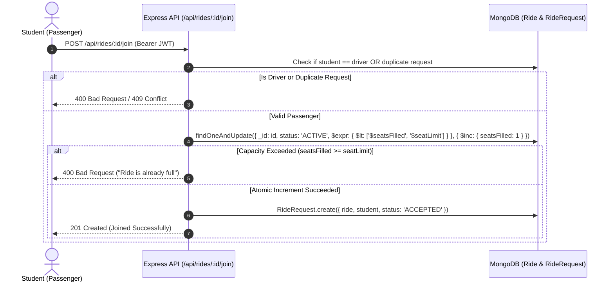

# 🚗 Campus Carpooling Platform (Case Study 155) - Backend REST API

A secure, high-performance Node.js & Express REST API built with MongoDB Atlas and Mongoose for college campus carpooling. The platform allows students to offer or join rides, enforces strict seat-capacity management (guaranteed against race conditions via atomic operations), and uses JWT-based ownership authorization.

---

## 📌 Features & Business Rules

1. **JWT Authentication & Passwords**:
   - Secure student registration & login with password hashing via `bcryptjs`.
   - Stateless JWT tokens passed in the `Authorization: Bearer <token>` header.
   - Student info (excluding password hash) automatically populated in authenticated contexts.

2. **Ride Management (CRUD)**:
   - Drivers post rides with route, departure time, and positive integer `seatLimit`.
   - Public/Private filtering by route (`?route=...`), date/time (`?time=...`), and status.
   - Soft-delete ride cancellation (marks status as `CANCELLED`).

3. **Ownership-Based Authorization**:
   - Only the driver who created a ride can update or cancel it, or view/moderate its join requests.
   - Non-owners attempting modifications receive `403 Forbidden`.

4. **Atomic Seat-Capacity Enforcement**:
   - When a passenger joins a ride:
     - The backend checks `seatsFilled < seatLimit` and atomicity is guaranteed using MongoDB `$expr` & `$inc`.
     - When `seatsFilled >= seatLimit`, join requests are immediately rejected (`400 Bad Request`).
     - Duplicate join requests by the same student are prevented via compound unique indexes (`409 Conflict`).
     - Drivers cannot join their own rides.
   - When a driver rejects an accepted request, `seatsFilled` is automatically decremented to free up the seat for other students.

---

## 🛠️ Technology Stack

- **Runtime**: Node.js (v18+)
- **Framework**: Express.js (v4.x)
- **Database**: MongoDB Atlas / MongoDB Local
- **ODM**: Mongoose (v8.x)
- **Authentication**: JSON Web Token (`jsonwebtoken`), `bcryptjs`
- **Configuration & Utilities**: `dotenv`, `cors`, `morgan`
- **Testing**: `supertest`, `mongodb-memory-server`

---

## 📂 Project Structure

```
campus-carpooling/
├── src/
│   ├── config/
│   │   └── db.js                    # MongoDB Atlas connection handler
│   ├── controllers/
│   │   ├── authController.js        # Register & Login controllers
│   │   ├── rideController.js        # Ride CRUD & Join controllers
│   │   └── rideRequestController.js # Ride Request list & status moderation
│   ├── middleware/
│   │   ├── authMiddleware.js        # JWT verification & req.user attachment
│   │   ├── ownershipMiddleware.js   # Driver ownership verification (403 guard)
│   │   └── errorMiddleware.js       # Centralized error handler & 404 handler
│   ├── models/
│   │   ├── Student.js               # Student Mongoose Schema
│   │   ├── Ride.js                  # Ride Mongoose Schema
│   │   └── RideRequest.js           # RideRequest Schema (compound unique index)
│   ├── routes/
│   │   ├── authRoutes.js            # /api/auth routes
│   │   └── rideRoutes.js            # /api/rides routes
│   └── app.js                       # Express application configuration
├── server.js                        # Application entry point & server listener
├── test/
│   └── api.test.js                  # 22 automated integration tests
├── thunder-collection_campus_carpooling.json # Thunder Client import collection
├── .env.example                     # Environment variables template
├── .env                             # Active environment configuration
├── .gitignore                       # Git ignore configuration
├── package.json                     # Dependencies and scripts
└── README.md                        # Documentation
```

---

## ⚙️ Environment Variables

Create a `.env` file in the root directory (based on `.env.example`):

```env
PORT=5000
MONGODB_URI=mongodb+srv://<username>:<password>@cluster0.mongodb.net/campus_carpooling?retryWrites=true&w=majority
JWT_SECRET=your_super_secret_jwt_key_here
JWT_EXPIRES_IN=7d
```

> **Note**: Replace `<username>`, `<password>`, and cluster URL with your MongoDB Atlas credentials.

---

## 🚀 Getting Started

### 1. Install Dependencies
```bash
npm install
```

### 2. Run Locally in Development Mode (with hot reloading)
```bash
npm run dev
```

### 3. Run Locally in Production Mode
```bash
npm start
```

### 4. Run Automated Test Suite (22 Comprehensive Tests)
```bash
npm test
```

---

## 🛡️ Seat Capacity & Atomic Update Architecture

### Join Flow:


---

## 📖 API Endpoints Reference

### 1. Authentication Endpoints

#### `POST /api/auth/register`
- **Access**: Public
- **Request Body**:
```json
{
  "name": "Rahul Sharma",
  "email": "rahul.sharma@college.edu",
  "password": "CollegePass123",
  "phone": "+91 9876543210"
}
```
- **Response (201 Created)**:
```json
{
  "success": true,
  "message": "Student registered successfully",
  "data": {
    "student": {
      "_id": "66f68c74a58bf37e2cb0b001",
      "name": "Rahul Sharma",
      "email": "rahul.sharma@college.edu",
      "phone": "+91 9876543210",
      "createdAt": "2026-09-27T12:00:00.000Z"
    },
    "token": "eyJhbGciOiJIUzI1NiIsInR5cCI6IkpXVCJ9..."
  }
}
```

#### `POST /api/auth/login`
- **Access**: Public
- **Request Body**:
```json
{
  "email": "rahul.sharma@college.edu",
  "password": "CollegePass123"
}
```
- **Response (200 OK)**:
```json
{
  "success": true,
  "message": "Login successful",
  "data": {
    "student": {
      "_id": "66f68c74a58bf37e2cb0b001",
      "name": "Rahul Sharma",
      "email": "rahul.sharma@college.edu",
      "phone": "+91 9876543210"
    },
    "token": "eyJhbGciOiJIUzI1NiIsInR5cCI6IkpXVCJ9..."
  }
}
```

---

### 2. Ride Management Endpoints

#### `POST /api/rides`
- **Access**: Private (Authenticated Student)
- **Headers**: `Authorization: Bearer <driver_token>`
- **Request Body**:
```json
{
  "route": "Kharghar Station to Campus Gate 1",
  "departureTime": "2026-10-01T08:30:00.000Z",
  "seatLimit": 3
}
```
- **Response (201 Created)**:
```json
{
  "success": true,
  "message": "Ride created successfully",
  "data": {
    "_id": "66f68c74a58bf37e2cb0b100",
    "driver": {
      "_id": "66f68c74a58bf37e2cb0b001",
      "name": "Rahul Sharma",
      "email": "rahul.sharma@college.edu",
      "phone": "+91 9876543210"
    },
    "route": "Kharghar Station to Campus Gate 1",
    "departureTime": "2026-10-01T08:30:00.000Z",
    "seatLimit": 3,
    "seatsFilled": 0,
    "status": "ACTIVE",
    "createdAt": "2026-09-27T12:00:00.000Z"
  }
}
```

#### `GET /api/rides`
- **Access**: Public
- **Query Params**:
  - `?route=Kharghar` (substring filter)
  - `?time=2026-10-01` (date filter)
  - `?status=ACTIVE` (default `ACTIVE`)
- **Response (200 OK)**:
```json
{
  "success": true,
  "message": "Rides retrieved successfully",
  "count": 1,
  "data": [ ... ]
}
```

#### `GET /api/rides/:id`
- **Access**: Public
- **Response (200 OK)**: Single ride object populated with driver information.

#### `PUT /api/rides/:id`
- **Access**: Private (Driver only)
- **Headers**: `Authorization: Bearer <driver_token>`
- **Request Body**:
```json
{
  "route": "Kharghar Station to Campus Academic Block",
  "seatLimit": 4
}
```
- **Response (200 OK)**: Returns updated ride document.
- **Unauthorized attempt**: Returns `403 Forbidden` (`"Forbidden: You are not authorized to manage this ride."`).

#### `DELETE /api/rides/:id`
- **Access**: Private (Driver only)
- **Headers**: `Authorization: Bearer <driver_token>`
- **Response (200 OK)**:
```json
{
  "success": true,
  "message": "Ride cancelled successfully",
  "data": {
    "_id": "66f68c74a58bf37e2cb0b100",
    "status": "CANCELLED"
  }
}
```

---

### 3. Ride Join & Moderation Endpoints

#### `POST /api/rides/:id/join`
- **Access**: Private (Passenger)
- **Headers**: `Authorization: Bearer <passenger_token>`
- **Response (201 Created)**:
```json
{
  "success": true,
  "message": "Successfully joined the ride",
  "data": {
    "request": {
      "_id": "66f68c74a58bf37e2cb0c200",
      "status": "ACCEPTED",
      "requestedAt": "2026-09-27T12:05:00.000Z"
    },
    "ride": {
      "_id": "66f68c74a58bf37e2cb0b100",
      "seatLimit": 3,
      "seatsFilled": 1
    }
  }
}
```
- **Response (400 Bad Request - Full)**:
```json
{
  "success": false,
  "message": "Ride is already full. No seats available."
}
```

#### `GET /api/rides/:id/requests`
- **Access**: Private (Driver only)
- **Headers**: `Authorization: Bearer <driver_token>`
- **Response (200 OK)**: List of all join requests with student details populated.

#### `PATCH /api/rides/:rideId/requests/:requestId`
- **Access**: Private (Driver only)
- **Headers**: `Authorization: Bearer <driver_token>`
- **Request Body**:
```json
{
  "status": "REJECTED"
}
```
- **Response (200 OK)**:
```json
{
  "success": true,
  "message": "Ride request status updated to REJECTED",
  "data": {
    "request": {
      "_id": "66f68c74a58bf37e2cb0c200",
      "status": "REJECTED"
    },
    "rideSeats": {
      "seatLimit": 3,
      "seatsFilled": 0,
      "seatsAvailable": 3
    }
  }
}
```

---

## 🧪 Thunder Client / Postman Testing Order

Import `thunder-collection_campus_carpooling.json` into Thunder Client or Postman and execute in this sequence:

| Step | Request Name | Method | URL / Description | Expected Status |
|---|---|---|---|---|
| **1** | Register (Driver) | `POST` | `/api/auth/register` (Rahul Sharma) | `201 Created` |
| **1b**| Register (Passenger 1) | `POST` | `/api/auth/register` (Pooja Verma) | `201 Created` |
| **1c**| Register (Passenger 2) | `POST` | `/api/auth/register` (Amit Patel) | `201 Created` |
| **2** | Login (Driver) | `POST` | `/api/auth/login` (Obtain driver JWT) | `200 OK` |
| **2b**| Login (Passenger 1) | `POST` | `/api/auth/login` (Obtain passenger 1 JWT) | `200 OK` |
| **3** | Create Ride | `POST` | `/api/rides` (`seatLimit: 1`) | `201 Created` |
| **4** | Get All Rides | `GET` | `/api/rides` | `200 OK` |
| **5** | Filter Rides by Route | `GET` | `/api/rides?route=Kharghar` | `200 OK` |
| **6** | Filter Rides by Time | `GET` | `/api/rides?time=2026-10-01` | `200 OK` |
| **7** | Get Ride by ID | `GET` | `/api/rides/:id` | `200 OK` |
| **8** | Update Own Ride | `PUT` | `/api/rides/:id` (by Driver) | `200 OK` |
| **9** | Try Updating Someone Else's Ride | `PUT` | `/api/rides/:id` (by Passenger) | `403 Forbidden` |
| **10**| Cancel Own Ride | `DELETE`| `/api/rides/:id` (by Driver) | `200 OK` |
| **11**| Join Ride | `POST` | `/api/rides/:id/join` (Passenger 1 -> `seatsFilled` becomes 1) | `201 Created` |
| **12**| Try Joining Full Ride | `POST` | `/api/rides/:id/join` (Passenger 2 -> Full) | `400 Bad Request` |
| **13**| Try Duplicate Join | `POST` | `/api/rides/:id/join` (Passenger 1 again) | `409 Conflict` |
| **14**| Get Ride Requests | `GET` | `/api/rides/:id/requests` (by Driver) | `200 OK` |
| **15**| Reject Request | `PATCH`| `/api/rides/:rideId/requests/:requestId` (`status: REJECTED` -> `seatsFilled` becomes 0) | `200 OK` |
| **16**| Accept Request | `PATCH`| `/api/rides/:rideId/requests/:requestId` (`status: ACCEPTED` -> `seatsFilled` becomes 1) | `200 OK` |
